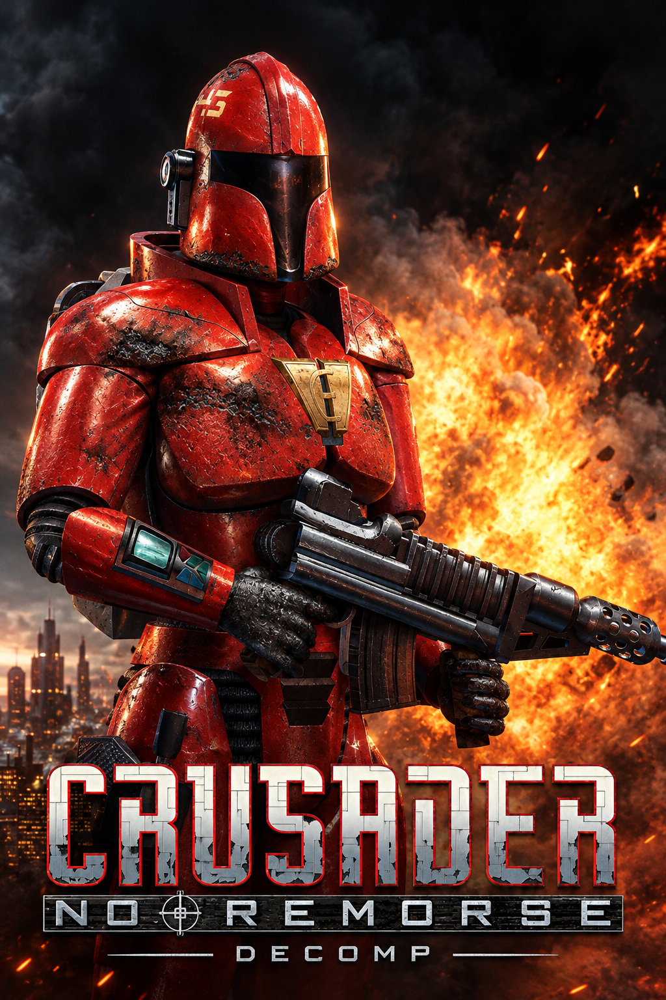

# Crusader: No Remorse — DECOMP



A C++20/SDL2 reimplementation of the *Crusader: No Remorse* (Origin, 1995) engine for Windows and Linux. The project is still a **work in progress**.

This repository contains **no game files**: you need your own copy of the original game. The following versions are currently supported:

- The **French version 1.08** (dated 12 October 1995) — ISO SHA-256: `B370436F2BA380500E918262A83293FBB89600253CC3F4579895D45FDB63B802`
- The **US version 1.23** (dated 13 February 1996) — ISO SHA-256: `C27D77D215253B8C1EF3C5B16CC33AFF63E759A843BBCD177A42F6A64DC063C7`

## Recent improvements

- Added gamepad support.
- Added an **Enhancements** menu to the Options menu, with:
  - Gamepad remapping
  - A camera that follows the player
  - Directional movement: the controller's left stick walks the Silencer where it points, as an alternative to the original tank controls
  - Directional aiming: the right stick puts the crosshair where it points
  - Native resolution: the view fills your screen (in whole-number pixel multiples, never stretched), showing more of the surroundings; the menus and cutscenes stay 640×480, centred
  - Zoom: choose the pixel size of the native view (Auto, or ×1 to ×4); ×1 gives the finest picture and the widest view
  - Autosave: the game saves itself when you pick up a keycard, open a door with a keycard or a code, open a chest with a code, start a level, and after each cutscene of the mission (a floppy disk shows in the corner). It uses its own slot, separate from your saves; load it from the last row of the load screen or press **F6**
- Fullscreen toggle: press **Alt+Enter** at any time to switch between windowed and fullscreen.
- **Keyboard and Mouse** mode (on by default; toggle it in Options → Enhancements):
  - **W / S** walk forward / backward, **A / D** step left / right, **Q / E** roll left / right. With the weapon drawn, **W** steps forward instead of walking. A step or roll pressed during another animation is done as soon as the character is free.
  - A free mouse pointer: the character faces it, and a drawn weapon aims exactly where it points, with no snapping to targets and no limit to a circle around the player. The weapon keeps its normal accuracy, so shots still scatter. The old targeting reticle (the **R** key) is gone.
  - The crosshair is a dot with four lines that move apart as the shot gets less accurate, so it shows where the bullets can land. A soft red laser dot marks where the aim ends, and stops on whatever is in the way.
  - **Left click** fires with the weapon drawn. With the weapon away it uses or picks up the item under the pointer (the pointer turns into a target symbol over such items, green when in reach, red when too far), or walks to the spot, so clicking never draws the weapon.
  - **Right click** draws the weapon, and a tap puts it away again. Holding it fires. The right button no longer walks. **Space** is back to its original role.
  - Click-to-walk uses an A* path search that goes round obstacles; hold **Shift** (or switch run on) to run along it. The route is drawn as a cyan debug line, including while you walk or run with the keys.
  - A slim health bar appears above whatever you hit, for a few seconds.
- The game asks SDL for its OpenGL renderer (and falls back if it is not available). A small overlay in the top-right corner shows the FPS, hardware or software mode, the game loop's time per pass and tick rate (`--no-fps` hides it).
- New command-line options: `--skip-movies` skips all videos, `--keyboard-mouse` forces the Keyboard and Mouse mode on for that run, `--no-fps` hides the overlay.

## Planned improvements

- Release the game on PortMaster.
- Support additional versions of *Crusader: No Remorse*, if there is interest.
- Explore the possibility of supporting *Crusader: No Regret*.
- Have an idea? Let me know what you'd like to see!

Further improvements will come when my Claude subscription renews. If you'd like to help speed things up, feel free to leave a small tip (see [SPONSORING.md](SPONSORING.md)).

## Running the game

### 1. Download

Download the latest release from the [Releases](https://github.com/sebsebseb1982/crusader-no-remorse-decomp/releases) page:

- Windows: `crusader-X.Y.Z-windows-x64.zip` (SDL2 is built into the executable)
- Linux: `crusader-X.Y.Z-linux-x64.tar.gz` — requires SDL2: `sudo apt install libsdl2-2.0-0` (or your distribution's equivalent)
- aarch64 handhelds (PortMaster: muOS, Knulli, ROCKNIX, ArkOS…): `crusader-X.Y.Z-portmaster-aarch64.zip` — see [`tools/portmaster/README.md`](tools/portmaster/README.md)

Checksums are in `SHA256SUMS`.

### 2. Provide the game data

The archive contains the executable and an empty `data` folder with a `PUT_GAME_DATA_HERE.txt` note. Add the game data from your copy of either supported version (French 1.08 or US 1.23) in one of these ways:

- **CD image:** Place the `.iso` file in `data/`, or pass its path to the game (for example, `./crusader game.iso`). On first launch, the game extracts the data to `data/` (about 550 MB; this takes a few seconds). You can delete the ISO afterward.
- **Installed game or CD files:** Copy the **entire contents** of the installation folder or CD into `data/`:

```
crusader(.exe)
data/
├── CRUSADER.CFG        settings
├── STATIC/             shapes, palettes, fonts, maps, tables  (SHAPES.FLX, FIXED.DAT, GLOB.FLX, TYPEFLAG.DAT, ANIM.DAT, GUMPS.FLX, FONTS.FLX, *.PAL, …)
├── USECODE/            game scripts  (EUSECODE.FLX, UNKCOFF.DAT, UNKDS.DAT)
├── SOUND/              sound effects and music  (SOUND.FLX, M01.AMF … M16C.AMF, MENU.AMF, CRED.AMF)
├── FLICS/              cutscenes  (*.AVI and their subtitles *.TXT)
└── SAVEGAME/           saved games (optional for a new game)
```

### 3. Launch

```sh
./crusader data --new-game        # Windows: crusader.exe data --new-game
./crusader data --save 1          # resumes SAVEGAME.1 from the data folder
./crusader --version
```

## Building from source

Requirements: CMake 3.21 or later and a C++20 compiler (Visual Studio 2022, GCC 11+, or Clang 14+).

```sh
cmake -S . -B build -DCMAKE_BUILD_TYPE=Release     # Windows: -G "Visual Studio 17 2022" -A x64
cmake --build build --config Release
ctest --test-dir build -C Release --output-on-failure
```

If SDL2 is installed on your system, the build uses it (`libsdl2-dev` on Linux). Otherwise, SDL2 is downloaded and built automatically.

On Windows the project also builds with MSYS2 (UCRT64: `cmake -S . -B build -G Ninja -DCMAKE_BUILD_TYPE=Release`, then `cmake --build build`).

The tests in `tests/` do not require game data. The end-to-end tests in `e2e/` use the original game data and are registered only when it is found (`-DCRUSADER_DATA_DIR=…`; defaults to `data/`). Tests that load saved games read them from `-DCRUSADER_TEST_SAVES_DIR=…` and are skipped if that directory is absent. `us_data_tests` runs when US game data is found (`-DCRUSADER_US_DATA_DIR=…`; defaults to `data_us/`).

In addition to `crusader`, the build produces several tools: `shapeview` (shape viewer), `mapview` (map viewer), `ucsmoke` and `useprobe` (script execution), and `diffcheck` (comparison with the original).

## Versioning

Versions follow [SemVer](https://semver.org) and are calculated automatically from [Conventional Commits](https://www.conventionalcommits.org): `fix:` increments the patch version, `feat:` increments the minor version, and `BREAKING CHANGE` increments the major version (or the minor version before `1.0`). Every release is built and tested on Linux and Windows, and cross-compiled for PortMaster. See [`docs/RELEASING.md`](docs/RELEASING.md) for details.

## Contribution

Contributions are welcome; see [CONTRIBUTING.md](CONTRIBUTING.md) for the full guide. For substantial changes, please open an issue first to discuss the proposed approach. When reporting a bug, include the game version, operating system, screenshot, savegame, steps to reproduce it, and any relevant error messages or logs.

Pull requests should describe the change and its purpose, stay focused, and include tests where appropriate. Before submitting one, build the project and run the available tests:

```sh
cmake --build build --config Release
ctest --test-dir build -C Release --output-on-failure
```

Tests that require the original game data will run only when the data is available and configured as described above.

## License and rights

The port's code and documentation are released under the [GNU GPL v3](LICENSE) or, at your option, any later version. You may use, study, modify, and redistribute them, provided that every redistributed version, modified or not, remains under the same license and includes its source code.

This license applies only to this repository. *Crusader: No Remorse* remains the property of its rights holders. This project does not distribute the game's code, data, or screenshots. You must own a copy of the game to play it.
